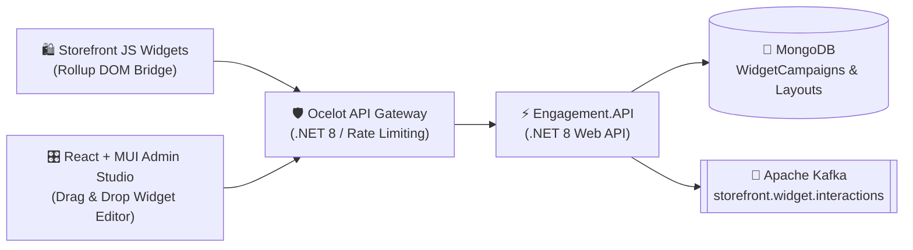

# ⚙️ .NET 8 E-Commerce Engagement Microservices & Ocelot API Gateway

Production-grade **C# / .NET 8 microservice architecture** designed for high-traffic e-commerce storefronts (Shopify, Ideasoft, Ikas, and custom Next.js storefronts). Powers real-time DOM widget configurations (**Flash Products, Smart Cart Upsell Recommendations, Spin-the-Wheel promotions, and Drag-and-Drop layout persistence**) backed by **MongoDB**, **Apache Kafka**, and **Ocelot API Gateway**.

---

## 🏗️ System Architecture



---

## ✨ Key Architectural Highlights

- **🛡️ Ocelot API Gateway (`src/ApiGateway`):**
  - Centralized routing (`/gateway/campaigns/*`, `/gateway/recommendations/*`), CORS policy enforcement for cross-domain storefront widget scripts, and request rate-limiting.
- **⚡ Engagement Microservice (`src/Engagement.API`):**
  - Built with **.NET 8 & C# 12** primary constructors, strongly-typed options pattern, and clean separation across `Domain`, `Infrastructure`, and `Controllers`.
  - **Drag-and-Drop (DnD) Layout Persistence:** Partial document updates in MongoDB (`UpdateLayoutAsync`) allowing merchants to reorder and theme storefront widgets in real time.
  - **Smart Cart Upsell & Weighted Spin-the-Wheel Engine:** Sub-millisecond evaluation endpoints calculating free-shipping thresholds, complementary SKUs, and probability-weighted coupon rewards.
- **🍃 MongoDB Document Store:**
  - Flexible NoSQL schema for multi-tenant widget configurations, custom CSS/theme overrides, and platform selectors.
- **📨 Event-Driven Telemetry with Apache Kafka:**
  - Asynchronous event streaming (`Confluent.Kafka`) capturing widget impressions, clicks, wheel spins, and cart conversions without blocking storefront HTTP responses.

---

## 📂 Solution Structure

```text
dotnet8-ecommerce-microservices/
├── EcommerceMicroservices.sln
├── docker-compose.yml
└── src/
    ├── ApiGateway/
    │   ├── OcelotGateway.csproj
    │   ├── Program.cs
    │   └── ocelot.json
    └── Engagement.API/
        ├── Engagement.API.csproj
        ├── Program.cs
        ├── appsettings.json
        ├── Controllers/
        │   ├── CampaignsController.cs
        │   └── RecommendationsController.cs
        ├── Domain/
        │   ├── Entities/WidgetCampaign.cs
        │   └── Events/WidgetInteractionEvent.cs
        └── Infrastructure/
            ├── Data/MongoDbContext.cs
            ├── Messaging/KafkaEventProducer.cs
            └── Repositories/CampaignRepository.cs
```

---

## 🚀 Quick Start (Docker Compose)

Spin up the entire stack (**Ocelot Gateway + Engagement API + MongoDB 7.0 + Apache Kafka**) with a single command:

```bash
docker-compose up --build -d
```

- **Ocelot Gateway:** `http://localhost:5000/health`
- **Engagement API Swagger UI:** `http://localhost:5001/swagger`

---

## 🔌 Core API Endpoints

| Method | Endpoint | Description |
| :--- | :--- | :--- |
| `GET` | `/api/v1/campaigns/tenant/{tenantId}` | Fetch active storefront widgets ordered by DnD display priority |
| `POST` | `/api/v1/campaigns` | Create a new Flash Product, Cart Upsell, or Spin-the-Wheel campaign |
| `PUT` | `/api/v1/campaigns/{id}/layout` | Persist Drag-and-Drop (DnD) widget layout & theme settings |
| `POST` | `/api/v1/campaigns/{id}/telemetry` | Stream widget interaction telemetry to Apache Kafka |
| `POST` | `/api/v1/recommendations/cart-upsell` | Evaluate cart subtotal & return dynamic upsell SKU recommendations |
| `POST` | `/api/v1/recommendations/spin-wheel/resolve` | Resolve probability-weighted Spin-the-Wheel coupon slice |

---

## 👨‍💻 Author

**Murat Ertuğral** — Full Stack Engineer (React, Next.js, TypeScript, .NET 8)
- 🌐 Portfolio: [muratertugral.vercel.app](https://portfolio-chi-jet-58.vercel.app)
- 💼 LinkedIn: [linkedin.com/in/murat-ertugral](https://www.linkedin.com/in/murat-ertugral)
